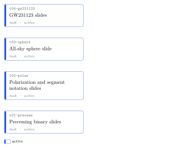

<!-- GENERATED by `opsci map build` from the node headers. Do not edit this file; edit the headers. -->

# Project graph

Each card is a node; its colour shows the status. An arrow from A to B means B depends on
A; an arrow that a longer path of arrows already implies is left out (the table lists
every dependency). Dashed arrows point from a node to the node that superseded it, and
from a node to the verification task that verified it. Dotted lines join related nodes.

## Nodes

| id | title | type | status | verification | depends on | summary |
|---|---|---|---|---|---|---|
| [t01-precess](../tasks/t01-precess/context.md) · [map](../tasks/t01-precess/map.md) | Precessing binary slides | task | active | unverified |  | Slides comparing a non-precessing and a precessing Newtonian binary, then face-on and edge-on detectors around the precessing one. |
| [t02-polar](../tasks/t02-polar/context.md) · [map](../tasks/t02-polar/map.md) | Polarization and segment notation slides | task | active | unverified |  | Ring of test masses beside the line-segment notation, for circular and plus polarization. |
| [t03-sphere](../tasks/t03-sphere/context.md) · [map](../tasks/t03-sphere/map.md) | All-sky sphere slide | task | active | unverified |  | Binary with rings at four directions, then segments, then a draggable sphere of segments on a white background. |
| [t04-gw231123](../tasks/t04-gw231123/context.md) · [map](../tasks/t04-gw231123/map.md) | GW231123 slides | task | active | unverified |  | Title and spin posterior of the LVK GW231123 paper, then its zoomed sphere at the actual viewing angle beside the whitened waveform. |
